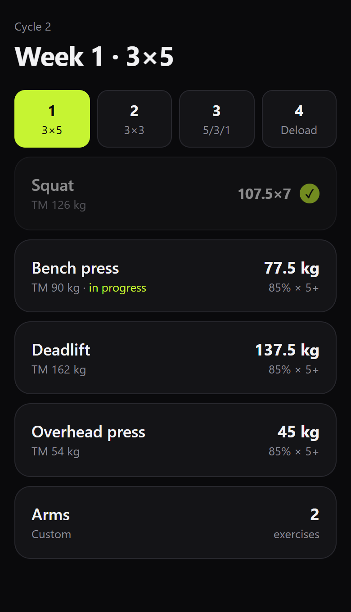
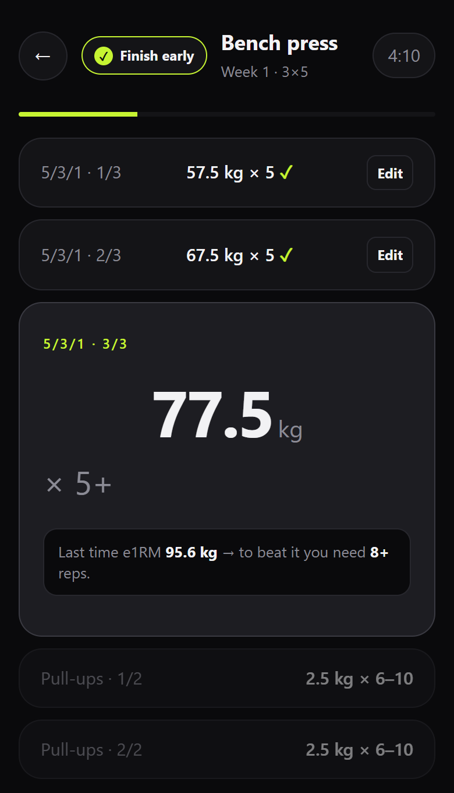
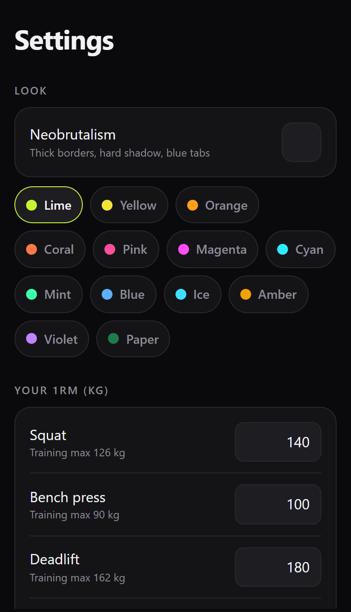
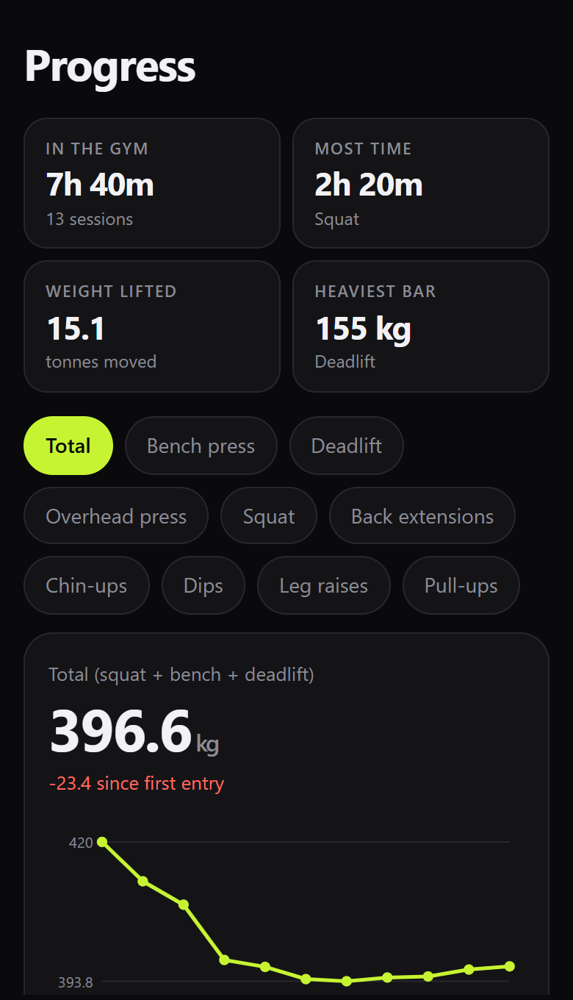
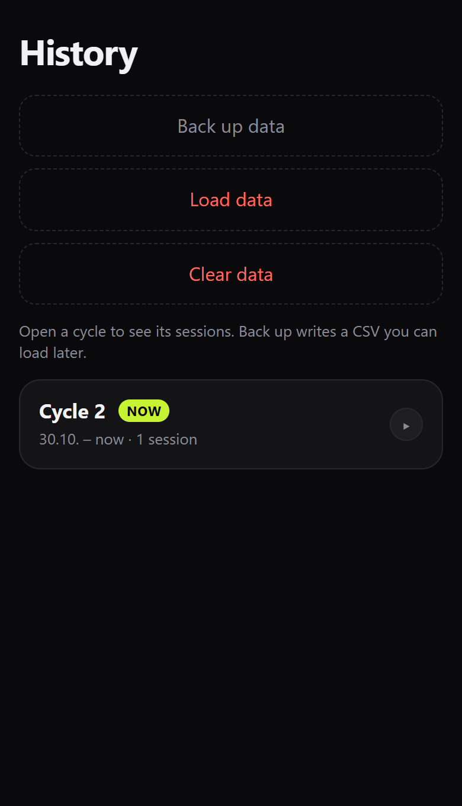

# 5/3/1 Training

Osobni trening dnevnik za ciklus **5/3/1**. Radi u browseru i kao Android aplikacija. Isti ekran, isti podaci na tom uređaju.

Nije službena aplikacija programa niti zamjena za knjigu. Postoci i predlošci su uobičajena shema tog stila treninga, zapisani ovdje kao kalkulator i dnevnik serija.

## Ekrani

Tjedan s četiri lifta i dodatnim danom. Kvačica znači da je dan odrađen, „in progress” da je trening otvoren.



Otvoren bench: gotove serije, trenutna kilaža, plus serija i pomoćne vježbe.



Postavke: boja, 1RM i training max. Ispod toga su glavni rad, supplemental, jokeri i pomoćne vježbe.



Napredak zbraja odrađene treninge i crta ukupni squat + bench + deadlift.



Povijest drži cikluse. Backup je CSV, load ga vraća.



Slike gore su demo podaci, ne nečiji stvarni dnevnik.

## Kako se trenira

Četiri lifta: squat, bench press, deadlift, overhead press. Ciklus ima četiri tjedna.

1. U **Settings** upišeš 1RM za svaki lift. Training max je postotak tog 1RM-a (zadano 90%), zaokružen na korak (zadano 2,5 kg).
2. Na **Training** odabereš tjedan i lift. Aplikacija složi zagrijavanje, glavne serije, supplemental i pomoćne vježbe.
3. Svaku seriju označiš čim je gotova. Težina i ponavljanja se spremaju odmah. Ako zatvoriš aplikaciju usred treninga, dan ostaje „in progress”.
4. Tjedan 1 je 3×5, tjedan 2 je 3×3, tjedan 3 je 5/3/1, tjedan 4 je deload. Zadnja glavna serija u prva tri tjedna je plus serija (AMRAP), osim ako uključiš 5's PRO.
5. Kad su sva četiri lifta gotova, tjedan može dalje. **Finish cycle** postoji samo na tjednu 4. Training max se ne miče usred ciklusa. Na kraju ciklusa predloži se povećanje ako su tjedni 1–3 odrađeni, a ti upišeš broj koji želiš.

Standardni tjedan, u postotku training maxa:

| Tjedan | Serije |
| --- | --- |
| 1 | 65% × 5, 75% × 5, 85% × 5+ |
| 2 | 70% × 3, 80% × 3, 90% × 3+ |
| 3 | 75% × 5, 85% × 3, 95% × 1+ |
| 4 | 40% × 5, 50% × 5, 60% × 5 |

## Što se može uključiti

**Glavni rad:** Standard 5/3/1, Volume 75/85, SVR, 3/5/1, Advanced, Spinal Tap, Spinal Tap triples, ili None (ostaju supplemental i pomoćne).

**Supplemental**, jedan po izboru: Boring But Big u nekoliko varijanti, First Set Last, Second Set Last, Boring But Strong, Widowmaker, GVT, Rule of 50, Rule of 10, SST, Pyramid, ili ništa. Teški BBB predlošci preskaču deload. Posebno se može ugasiti sav supplemental na tjednu 4.

**Dodaci:** 5's PRO (sve glavne serije su točno 5, bez plusa), extra top setovi, dynamic work, joker supersets, high-intensity deload. Jokeri mogu biti ugašeni, ručni ili automatski.

**Pomoćne vježbe** su po danu lifta: ime, broj serija i raspon ponavljanja. Ako sve serije padnu na gornju granicu, sljedeći put ide teže. **Extra days** su dani samo s tvojim vježbama. Ne pomiču tjedan.

Težina glavnih i zagrijavajućih serija je zaključana na izračun. Pomoćne i supplemental možeš korigirati. Odrađenu seriju možeš otvoriti na Edit i promijeniti kilažu, ponavljanja ili made/missed.

## Gdje žive podaci

Sve je u jednom JSON-u pod ključem `f531v1` (browser `localStorage`, na Androidu WebView storage te aplikacije). Nema računa i nema servera.

**History → Back up data** sprema CSV. Na telefonu Android ga stavlja u Downloads. **Load data** čita taj CSV natrag. Deinstalacija aplikacije briše spremljeno. Nova instalacija preko stare zadržava podatke ako je paket isti: `app.f531.training`.

## Pokretanje

Browser: otvori `app/src/main/assets/index.html`. To je cijela aplikacija, jedan file.

Android: otvori ovaj folder u Android Studiju. Treba SDK 35 i `local.properties` s putanjom do SDK-a (Android Studio ga napiše sam, datoteka nije u gitu). `minSdk` je 24. Aplikacija učitava HTML iz asseta kroz WebView. Debug APK se ne commita.

U Android Studiju: **Build → Build APK(s)**. Iz komandne linije, ako je Gradle instaliran:

```bash
gradle assembleDebug
```

Gotov APK je `app/build/outputs/apk/debug/app-debug.apk`. Build mapa i APK nisu u gitu.
